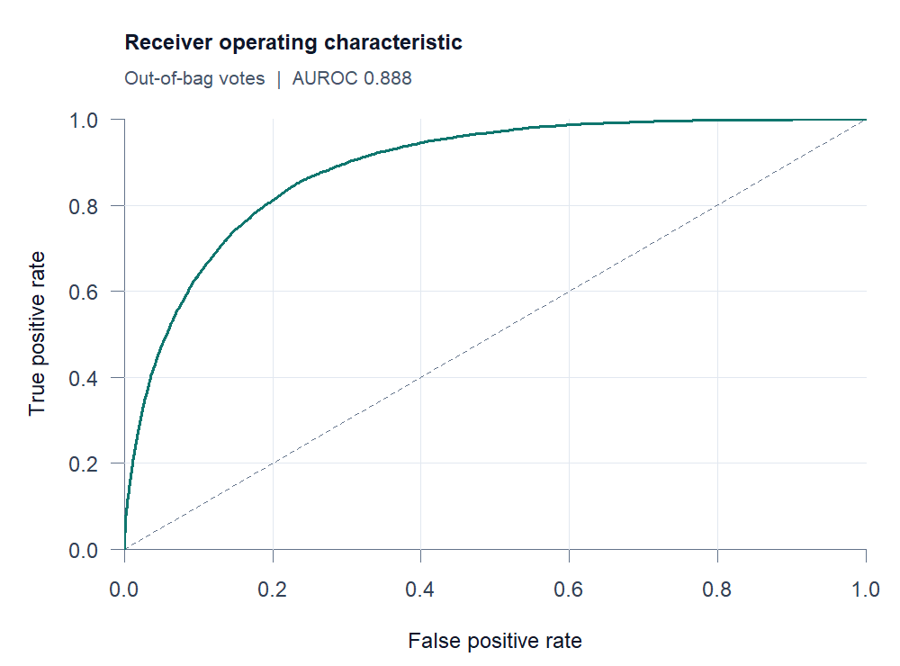
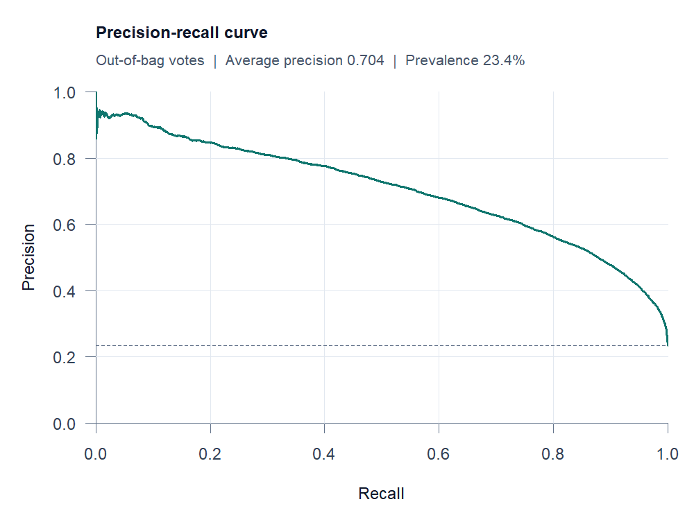

# m6APrediction

`m6APrediction` is an R package for predicting N6-methyladenosine (m6A) status in RNA sites using a random forest model developed in BIO215 Practical 5.

The package supports single-site and multiple-site prediction based on sequence and RNA-related features. It includes a fitted random forest model and an example dataset.

## Installation

Install the package from GitHub:

```r
install.packages("remotes")
remotes::install_github("water443/m6APrediction")
```

## Usage

Load the package and the example data:

```r
library(m6APrediction)

ml_fit <- readRDS(system.file(
  "extdata", "rf_fit.rds",
  package = "m6APrediction",
  mustWork = TRUE
))

features <- read.csv(system.file(
  "extdata", "m6A_input_example.csv",
  package = "m6APrediction",
  mustWork = TRUE
))
```

### Multiple-site prediction

```r
predictions <- prediction_multiple(
  ml_fit,
  head(features, 3),
  positive_threshold = 0.6
)

predictions[, c(
  "predicted_m6A_prob",
  "predicted_m6A_status"
)]
```

The function returns the input data with two additional columns: predicted probability and predicted m6A status.

### Single-site prediction

```r
result <- prediction_single(
  ml_fit,
  gc_content = 0.6,
  RNA_type = "mRNA",
  RNA_region = "CDS",
  exon_length = 12,
  distance_to_junction = 5,
  evolutionary_conservation = 0.8,
  DNA_5mer = "GGACA",
  positive_threshold = 0.5
)

result
```

The function returns a named vector containing the predicted probability and classification status.

## Input Features

The prediction model uses seven input features:

- `gc_content`
- `RNA_type`
- `RNA_region`
- `exon_length`
- `distance_to_junction`
- `evolutionary_conservation`
- `DNA_5mer`

The DNA sequence must contain five uppercase nucleotide bases (A, T, C and G), with A at the central position.

Exon length and distance to junction should use the log2-transformed values consistent with the course dataset.

## Model Performance

Model performance was evaluated using out-of-bag (OOB) predictions from the fitted random forest model.

- AUROC: 0.888
- Average Precision: 0.704
- Positive-class prevalence: 23.4%

These results represent internal model performance on the BIO215 course dataset.

### ROC Curve



### Precision-Recall Curve



## Documentation

Function documentation is available in R:

```r
?prediction_multiple
?prediction_single
```
